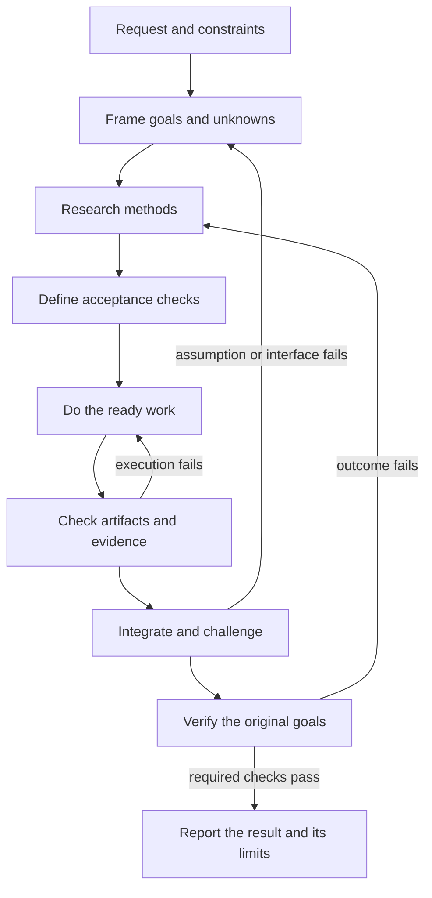

<div align="center">

# Solve with Evidence

A portable skill that takes a multi-step problem from framing through research, execution, and a checked result.

Any coding agent that can read a `SKILL.md` folder can use it.

</div>

The installable skill is [`solve-with-evidence/`](solve-with-evidence/SKILL.md): instructions, references, and one Python script. The repository root is not itself a skill directory. Cloning the repo does not turn the skill on. Copy that folder into the skills directory your agent already scans.

There is no license file, version tag, or CI workflow in this repository, so this page does not show badges for them.

## Why

Agents often finish when the plan is written. A plan is evidence that a plan exists. It is not evidence that the plan was carried out, that the totals add up, or that a file is the one a checker accepted.

This skill is a procedure for that gap. The host agent keeps the original request, chooses methods, defines a check before the expensive work, and withholds a completion claim the evidence does not support. The instructions grant no new authority, access, credentials, budget, or professional qualification. Nothing here is an orchestration service, and nothing here licenses the reader to practice a profession.

Use the full loop when the work crosses disciplines, needs a real choice of tool or method, or has to be defended. Scale it down, or skip the research survey, for a request you can check directly.

## The loop



The diagram is the operating picture in [architecture.md](solve-with-evidence/references/architecture.md). Stages are work, not seven mandatory meetings. One agent can cover several roles. Independent review, when you need it, needs someone who did not produce the result.

The only program in the skill is a byte-preserving handoff for a JSON object. This is the run from this checkout, Python 3.12 on Linux. The consumer exits 0 when `ok` is true. The receipt names a file whose contents are the bytes the consumer read:

```text
$ printf '%s\n' '{"ok":true}' > /tmp/swe-candidate.json
$ python3 solve-with-evidence/scripts/json_handoff.py /tmp/swe-candidate.json \
    --deliver-to /tmp/swe-demo -- \
    python3 -c 'import json,sys; sys.exit(0 if json.load(sys.stdin).get("ok") is True else 1)'
{"path": "/tmp/swe-demo/e5f1eb4d806641698a35efe20e098efd20d7d57a9b90ee69079d5bb650920726.json", "sha256": "e5f1eb4d806641698a35efe20e098efd20d7d57a9b90ee69079d5bb650920726", "bytes": 12}
```

The same command on `{"ok":false}` prints `received rejected: independent consumer did not explicitly accept the payload` to stderr, exits 1, and writes no file.

## Quickstart

From a shell, with Python 3:

```sh
git clone https://github.com/Emuthmartinez/solve-with-evidence.git
cd solve-with-evidence

mkdir -p /tmp/swe-demo
printf '%s\n' '{"ok":true}' > /tmp/swe-candidate.json
python3 solve-with-evidence/scripts/json_handoff.py /tmp/swe-candidate.json \
  --deliver-to /tmp/swe-demo -- \
  python3 -c 'import json,sys; sys.exit(0 if json.load(sys.stdin).get("ok") is True else 1)'
```

A successful run prints one JSON object and leaves a read-only `<sha256>.json` in `/tmp/swe-demo`. The digest above is for the twelve bytes `{"ok":true}` plus a newline.

Install the skill for every agent that reads the shared skills directory (Codex, Cursor, Gemini CLI, and Copilot all do; Claude Code does not):

```sh
mkdir -p ~/.agents/skills
cp -a solve-with-evidence ~/.agents/skills/solve-with-evidence
```

Open a new session and ask for `solve-with-evidence`, or invoke it the way that agent invokes skills. The per-agent section has the paths and the commands that differ.

## Install for your agent

The folder you copy must be the skill directory, so `SKILL.md` sits directly inside `solve-with-evidence/`. Copying the repository root into a skills directory does not install it.

`gh skill` finds this skill at the repository root even though it does not live under a `skills/` directory. Install it by name:

```sh
gh skill install Emuthmartinez/solve-with-evidence solve-with-evidence --agent github-copilot
```

`--agent` selects the host. `gh skill install --help` lists the names it knows, including `claude-code`, `cursor`, `codex`, and `gemini-cli`. Add `--scope user` for a home-directory install. The default scope is the current git repository. From a local checkout, `gh skill install . solve-with-evidence --from-local` copies the same folder. The installer writes source-tracking fields into the installed copy's frontmatter. It does not modify this repository.

<details>
<summary>Codex</summary>

Codex reads `.agents/skills/` from the working directory up through the repo root, `$HOME/.agents/skills/`, and the older `$CODEX_HOME/skills/` directory (`~/.codex/skills` unless `CODEX_HOME` is set).

The copy in the quickstart is enough. Inside a Codex session you can also ask the bundled installer to fetch the folder. It installs into `~/.codex/skills`, which Codex still scans:

```text
$skill-installer install https://github.com/Emuthmartinez/solve-with-evidence/tree/main/solve-with-evidence
```

Restart the session if the new skill does not appear. Invoke it with `$solve-with-evidence`, or let Codex select it when the request matches the description. `$skill-name` is Codex syntax. See [Build skills](https://learn.chatgpt.com/docs/build-skills).

</details>

<details>
<summary>Claude Code</summary>

Claude Code loads project skills from `.claude/skills/` and personal skills from `~/.claude/skills/`. It does not use `.agents/skills/`.

```sh
mkdir -p ~/.claude/skills
cp -a solve-with-evidence ~/.claude/skills/solve-with-evidence
```

The file must be `~/.claude/skills/solve-with-evidence/SKILL.md`. Invoke it with `/solve-with-evidence`. Claude also loads the skill when the description matches. See [Extend Claude with skills](https://code.claude.com/docs/en/skills).

</details>

<details>
<summary>Cursor</summary>

Cursor loads `.agents/skills/`, `.cursor/skills/`, `~/.agents/skills/`, and `~/.cursor/skills/`. For compatibility it also reads `.claude/skills/`, `.codex/skills/`, and the same two directories under your home folder.

Commit a project copy at `.agents/skills/solve-with-evidence/` or `.cursor/skills/solve-with-evidence/` if the skill should travel with the repo. User-level skills stay on that machine. Cursor does not copy `~/.agents/skills/` into Cloud Agents. In Agent chat, type `/` and select `solve-with-evidence`. See [Agent Skills](https://cursor.com/docs/skills).

</details>

<details>
<summary>Gemini CLI</summary>

Gemini CLI reads `.gemini/skills/` and `.agents/skills/` in the workspace and under your home directory. Within one tier, `.agents/skills/` wins on a name clash. The quickstart copy is enough. You can also install from Git, using `--path` because the skill is not at the repository root:

```sh
gemini skills install https://github.com/Emuthmartinez/solve-with-evidence.git --path solve-with-evidence
```

Gemini asks before it activates a skill. `/skills list` shows whether this one was discovered. See [Agent Skills](https://geminicli.com/docs/cli/skills/).

</details>

<details>
<summary>GitHub Copilot</summary>

Copilot reads project skills from `.github/skills/`, `.claude/skills/`, and `.agents/skills/`. Personal skills live in `~/.copilot/skills/` or `~/.agents/skills/`. The quickstart copy covers the personal shared path. Copilot chooses the skill from its description. A laptop install is not automatically present in a cloud session. Use GitHub's own setup for that surface: [Adding agent skills for GitHub Copilot](https://docs.github.com/en/copilot/how-tos/copilot-on-github/customize-copilot/customize-cloud-agent/add-skills).

</details>

## How it works

The host agent is the coordinator. It uses whatever tools, shell, and subagents it already has. The skill tells it how to spend them. References stay unloaded until a step needs them.

1. **Frame.** Keep the original request. Separate reported facts, observations, sourced claims, assumptions, and unknowns. Ask only when the answer would change the work and cannot be checked another way.
2. **Select.** Name the operation each part needs, then match it to an available agent, tool, or person. A role title is not competence. Use the smallest team that can do the work. Independent review needs a separate reviewer.
3. **Research.** Prefer primary sources. Distinguish established practice, documented product behavior, emerging evidence, and untested ideas. Skip this survey when the task is routine and directly checkable.
4. **Define checks first.** Every required goal needs an observable criterion that could reject a plausible bad result. A successful tool call is not an external outcome. A model's agreement is not a fact.
5. **Execute.** Hand workers an assignment and a return contract. Do not delegate authority the coordinator does not have. Reconcile a timed-out write before retrying it.
6. **Integrate.** Check units, populations, versions, and interfaces. Keep real disagreement visible. Locate a failure in the goal, the model of the problem, the evidence, the method, the execution, the integration, or the verifier before changing approach.
7. **Verify and report.** Trace each still-required part of the request to a deliverable and current evidence. Say what was checked, what is pending, and what would be needed next. A completed plan satisfies a request for a plan. It does not establish the result of carrying the plan out.

For a machine-consumed JSON object, the agent writes the producer bytes once and runs [`scripts/json_handoff.py`](solve-with-evidence/scripts/json_handoff.py). The script parses them as one UTF-8 JSON object (duplicate keys and non-finite numbers are rejected), runs the consumer you supply, and on success either reprints those bytes or publishes them under their SHA-256. It does not reformat, wrap, or repair the payload.

Contracts, validation cases, and the research notes behind the design are in [`references/`](solve-with-evidence/references).

## Examples

Ask the installed skill to refuse an ineligible choice instead of relaxing the constraint:

```text
Use solve-with-evidence. Compare these venue offers against capacity, step-free access, and a fixed budget. Recommend a venue only if it satisfies every hard constraint.
```

A recorded walkthrough of that shape is in [validation.md](solve-with-evidence/references/validation.md). Each of three fictional offers violated capacity, step-free access, or a $600 total budget. The agent reproduced the totals, found no eligible venue, and did not claim a selection.

Hand a JSON object to a checker you trust, and publish only the accepted bytes:

```sh
python3 solve-with-evidence/scripts/json_handoff.py candidate.json \
  --deliver-to outputs -- python3 your_consumer.py
```

The consumer reads stdin. Exit 0 means accept, 1 means reject, and any other exit, including a timeout, stops the handoff with status 2. On success the process prints a receipt:

```json
{"path": "/tmp/swe-demo/e5f1eb4d806641698a35efe20e098efd20d7d57a9b90ee69079d5bb650920726.json", "sha256": "e5f1eb4d806641698a35efe20e098efd20d7d57a9b90ee69079d5bb650920726", "bytes": 12}
```

Link or return `path`. Do not paste a second copy of the JSON into the chat and call that the delivery. If the consumer is unavailable, report the blocker and do not substitute an earlier unchecked file.

Hosts that require the JSON inline, with no file, can omit `--deliver-to`. The process then writes the accepted bytes to stdout unchanged. A later message composed by the model is not that channel.

## Configuration

The skill has no config file and no environment variables. Depth is a judgment: the instructions say to scale the loop to the problem and to skip the research survey for routine, directly checkable work. Resource limits belong to the host and the user's scope. The architecture notes suggest, as a design default rather than a measured constant, one retry after a diagnosed transient failure and two evidence-driven revisions before replanning.

`json_handoff.py` is the configurable piece. It uses the Python standard library.

| Argument | Behavior |
|---|---|
| `received` | Path to the exact producer bytes. |
| `--` `consumer...` | Validator command. Stdin is the payload. Exit 0 accepts, 1 rejects. |
| `--deliver-to DIRECTORY` | Publish the accepted bytes in this directory and print a JSON receipt. The directory is created mode `0700` and must not be a symlink. |
| `--replacement PATH` | One alternate payload, checked only if `received` is rejected. |
| `--timeout SECONDS` | Wall time for each consumer attempt. Default 20. Must be positive. |

Exit 0 is acceptance. Exit 1 means every supplied payload was rejected. Exit 2 means the consumer timed out, could not be run, or returned something other than 0 or 1. The published file is named `<sha256>.json`, mode `0400`. A repeat of the same bytes links to the same file. A different payload already stored at that name is an error, not an overwrite.

File delivery uses a same-filesystem hard link. Use it on a POSIX filesystem. The run recorded above was Python 3.12 on Linux. The published model trials ran on macOS.

## Evidence

Two published comparisons, both run with Codex, bound what this repo has actually measured.

The [delivery benchmark](evaluations/delivery/README.md) gave the checker-approved file to the recipient in 12 of 12 normal trials, against 9 of 12 for the previous release. Both versions did so in all 6 native Codex shell trials. On a four-trial outage, the updated instructions withheld both payloads and the previous release delivered both without a successful check. Each cell was three synthetic cases, twice, under Codex CLI 0.166.0 with `gpt-6.1-sol` at medium effort. The package those trials loaded is [`evaluations/delivery/measured-package`](evaluations/delivery/measured-package). The installable wording was edited after that run. The trials were not repeated.

The [earlier repeated benchmark](evaluations/hard/README.md) covers six instruction versions, 182 completed two-turn trials, and 17 cases. The shipped instructions passed 32 of 34 trials and 453 of 466 points. The installed baseline passed 34 of 34 and 466 of 466. An [earlier five-case self-audit](evaluations/README.md) passed 25 of 25 criteria on both versions, with no observed difference. The cases are synthetic, the tools are restricted, and two trials per cell do not estimate reliability across professions, open-web research, or other agents.

## FAQ

**Does this only run in Codex?**
No. The instructions are an [Agent Skills](https://agentskills.io/specification) folder: `SKILL.md`, `references/`, and `scripts/`. Codex, Claude Code, Cursor, Gemini CLI, and Copilot can all load that format. The install paths differ. They are listed above.

**What is still Codex-specific?**

- `$skill-installer` writes to `~/.codex/skills`. Codex also reads `.agents/skills/`, so the shared copy works without that installer.
- `$solve-with-evidence` is Codex's invocation syntax. Claude Code and Cursor use `/solve-with-evidence`. Gemini CLI and Copilot select the skill from its description.
- Codex desktop can show a Markdown link to an absolute file path. Other hosts should surface the receipt path in whatever way their UI opens a file.
- `deliver_json` is a tool implemented by this repo's Codex app-server harness in [`evaluations/delivery/runner`](evaluations/delivery/runner/README.md). Other agents run `scripts/json_handoff.py`.
- The live-trial runners under `evaluations/hard` and `evaluations/delivery` speak the Codex app-server protocol and need a local Codex login. Replaying a saved trace does not call Codex. The executable wire case still needs macOS.

**Is there a server to start?**
No. There is no daemon, queue, or package to install with pip. The agent reads the instructions and uses its own tools.

**Will cloning this repo enable the skill in my project?**
No. Agents look for `SKILL.md` under their skills directories, not at the root of an unrelated checkout. Copy `solve-with-evidence/` into one of the directories in the install section.

**What if the checker is down?**
The script exits 2 and prints no receipt. The skill says to report the blocker and not to copy an unchecked staging file into the output directory.

**Can I put the JSON in the chat instead of a file?**
Only if the host forwards the script's accepted stdout straight to the recipient. A model that types the JSON again can change bytes. The skill says to disclose that limit rather than pretend the chat message is the checked artifact.

## Contributing

Edit [`solve-with-evidence/SKILL.md`](solve-with-evidence/SKILL.md) and the files in [`references/`](solve-with-evidence/references). Keep a claim next to the command or trial that supports it.

Do not edit [`evaluations/delivery/measured-package`](evaluations/delivery/measured-package), the snapshots under `evaluations/hard/snapshots/`, or trial records so that a new wording looks like the package a model was given. Those trees are the evidence. If the live skill changes, say so beside the delivery results. Audits of the saved trials read the frozen package, not the live folder.

From the repository root:

```sh
python3 -B evaluations/verify_evidence.py
python3 -B evaluations/verify_evidence.py \
  --manifest evaluations/delivery/distribution-manifest.json \
  --package evaluations/delivery/measured-package
python3 -B evaluations/delivery/test_artifact.py
python3 -B evaluations/delivery/runner/test_audit.py
```

Replaying the delivery matrices needs the sealed macOS evaluator for the executable wire case, and the native-link audit also needs `markdown-it-py` 4.0.0. Those commands are in [evaluations/delivery/README.md](evaluations/delivery/README.md). There is no CI workflow. Run the checks you touch before opening a pull request.

## License

This repository does not include a license file. Nothing in the skill text, the evaluation records, or this README grants permission to copy or reuse the work beyond what copyright law already allows.
