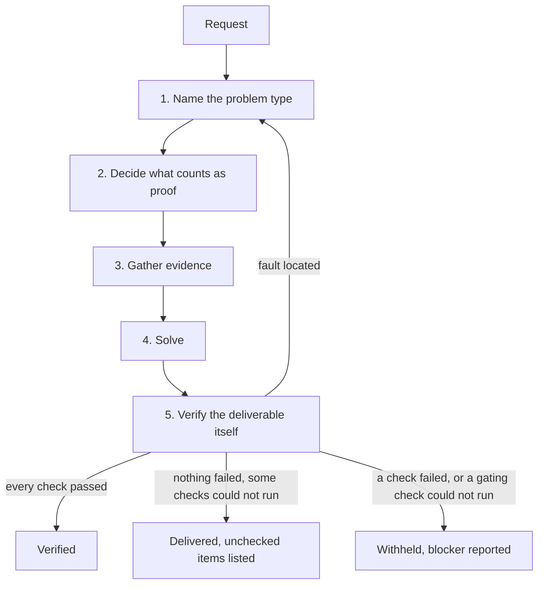

<div align="center">

# Solve with Evidence

Solve with Evidence makes an agent work out what kind of problem it has, decide what would count as proof, and hand over only what it checked, naming anything it could not check.

Any coding agent that can read a `SKILL.md` folder can use it.

</div>

The installable skill is [`solve-with-evidence/`](solve-with-evidence/SKILL.md): instructions, references, and three Python scripts. The repository root is not itself a skill directory. Cloning the repo does not turn the skill on. Copy that folder into the skills directory your agent already scans.

There is no license file, version tag, or CI workflow in this repository, so this page does not show badges for them.

**What is proven so far.** Not that the skill makes results better. No trial in this repository compares the skill with no skill. A benchmark built to do that is in [`evaluations/proof`](evaluations/proof/README.md). Its pass bar is committed, and it has not been run. [Evidence](#evidence) lists what the older trials do show.

## Why

Most prompts tell a model how to do the job. This skill has the agent identify the type of problem first, because the type decides what a real check looks like. Code is checked by running it. A decision is checked by recomputing it against the constraints. A factual claim is checked against a source passage. Writing is checked with a rubric that can tell a good example from a bad one, applied by a reviewer who did not write the draft.

The agent writes those checks before doing the work, then runs them on the thing it hands over. If a check cannot run, it says so. Every run ends in one of three outcomes: verified, delivered with a list of what could not be checked, or withheld.

None of these mechanisms is new. Routing by problem class, separating the solver from the verifier, and fail-closed delivery all have prior work, listed in [sources.md](solve-with-evidence/references/sources.md). This package combines them as portable instructions and three small scripts instead of a framework. It costs more time and tokens per task. The instructions grant no new authority, access, credentials, budget, or professional qualification.

Use the full loop when the work needs a real choice of method or has to be defended. Scale it down to a sentence per step for a request you can check directly.

## The loop



The problem type selects the check:

| Problem type | What counts as proof |
|---|---|
| Executable artifact | Run the delivered artifact against independently derived expected results |
| Decision under constraints | Recompute feasibility and the objective from the original requirements |
| Diagnosis | An observation that separates the competing explanations |
| Facts and research | Every number, name, quotation and claim traced to a source passage |
| Writing and design | A rubric that separates good from bad exemplars, applied by an independent reviewer |
| Operational change | Preconditions checked before, final state read back after |

The agent states the type it chose, because a wrong type passes its own check. The full table, including what does not count as proof, is in [`SKILL.md`](solve-with-evidence/SKILL.md).

The skill ships three standard-library Python scripts. [`json_handoff.py`](solve-with-evidence/scripts/json_handoff.py) delivers a JSON object byte for byte after a checker you supply accepts it. This is the run from this checkout, Python 3.12 on Linux. The consumer exits 0 when `ok` is true. The receipt names a file whose contents are the bytes the consumer read:

```text
$ printf '%s\n' '{"ok":true}' > /tmp/swe-candidate.json
$ python3 solve-with-evidence/scripts/json_handoff.py /tmp/swe-candidate.json \
    --deliver-to /tmp/swe-demo -- \
    python3 -c 'import json,sys; sys.exit(0 if json.load(sys.stdin).get("ok") is True else 1)'
{"path": "/tmp/swe-demo/e5f1eb4d806641698a35efe20e098efd20d7d57a9b90ee69079d5bb650920726.json", "sha256": "e5f1eb4d806641698a35efe20e098efd20d7d57a9b90ee69079d5bb650920726", "bytes": 12}
```

The same command on `{"ok":false}` prints `received rejected: independent consumer did not explicitly accept the payload` to stderr, exits 1, and writes no file.

[`claim_check.py`](solve-with-evidence/scripts/claim_check.py) maps each sentence of a prose draft to a source passage, or flags it. This is a run from this checkout, Python 3.15 on macOS. The notes say the outage lasted 47 minutes and quote one named customer:

```text
$ python3 solve-with-evidence/scripts/claim_check.py /tmp/swe-claims/draft.md --source /tmp/swe-claims/notes.md
FLAG unsupported line 2: number "2 days" not in any source
  We fixed it in 2 days.
FLAG unsupported line 3: quote "the response was excellent" not in any source; name "Priya Raman" not in any source
  Priya Raman said "the response was excellent".
1 of 3 sentences mapped, 2 flagged, 0 too short to check.
```

It exits 1 when anything is flagged. It locates where a claim could come from. It does not judge whether the passage supports the claim, so a clean run still needs a reader.

[`embedding_check.py`](solve-with-evidence/scripts/embedding_check.py) is optional and only warns. See [embedding check](solve-with-evidence/references/embedding-check.md) for the four uses it is valid for and why it must not judge correctness.

## Quickstart

From a shell, with Python 3:

```sh
git clone https://github.com/Emuthmartinez/solve-with-evidence.git
cd solve-with-evidence

mkdir -p /tmp/swe-demo
printf '%s\n' '{"ok":true}' > /tmp/swe-candidate.json
python3 solve-with-evidence/scripts/json_handoff.py /tmp/swe-candidate.json \
  --deliver-to /tmp/swe-demo -- \
  python3 -c 'import json,sys; sys.exit(0 if json.load(sys.stdin).get("ok") is True else 1)'
```

A successful run prints one JSON object and leaves a read-only `<sha256>.json` in `/tmp/swe-demo`. The digest above is for the twelve bytes `{"ok":true}` plus a newline.

Install the skill for every agent that reads the shared skills directory (Codex, Cursor, Gemini CLI, and Copilot all do; Claude Code does not):

```sh
mkdir -p ~/.agents/skills
cp -a solve-with-evidence ~/.agents/skills/solve-with-evidence
```

Open a new session and ask for `solve-with-evidence`, or invoke it the way that agent invokes skills. The per-agent section has the paths and the commands that differ.

## Install for your agent

The folder you copy must be the skill directory, so `SKILL.md` sits directly inside `solve-with-evidence/`. Copying the repository root into a skills directory does not install it.

`gh skill` finds this skill at the repository root even though it does not live under a `skills/` directory. Install it by name:

```sh
gh skill install Emuthmartinez/solve-with-evidence solve-with-evidence --agent github-copilot
```

`--agent` selects the host. `gh skill install --help` lists the names it knows, including `claude-code`, `cursor`, `codex`, and `gemini-cli`. Add `--scope user` for a home-directory install. The default scope is the current git repository. From a local checkout, `gh skill install . solve-with-evidence --from-local` copies the same folder. The installer writes source-tracking fields into the installed copy's frontmatter. It does not modify this repository.

<details>
<summary>Codex</summary>

Codex reads `.agents/skills/` from the working directory up through the repo root, `$HOME/.agents/skills/`, and the older `$CODEX_HOME/skills/` directory (`~/.codex/skills` unless `CODEX_HOME` is set).

The copy in the quickstart is enough. Inside a Codex session you can also ask the bundled installer to fetch the folder. It installs into `~/.codex/skills`, which Codex still scans:

```text
$skill-installer install https://github.com/Emuthmartinez/solve-with-evidence/tree/main/solve-with-evidence
```

Restart the session if the new skill does not appear. Invoke it with `$solve-with-evidence`, or let Codex select it when the request matches the description. `$skill-name` is Codex syntax. See [Build skills](https://learn.chatgpt.com/docs/build-skills).

</details>

<details>
<summary>Claude Code</summary>

Claude Code loads project skills from `.claude/skills/` and personal skills from `~/.claude/skills/`. It does not use `.agents/skills/`.

```sh
mkdir -p ~/.claude/skills
cp -a solve-with-evidence ~/.claude/skills/solve-with-evidence
```

The file must be `~/.claude/skills/solve-with-evidence/SKILL.md`. Invoke it with `/solve-with-evidence`. Claude also loads the skill when the description matches. See [Extend Claude with skills](https://code.claude.com/docs/en/skills).

</details>

<details>
<summary>Cursor</summary>

Cursor loads `.agents/skills/`, `.cursor/skills/`, `~/.agents/skills/`, and `~/.cursor/skills/`. For compatibility it also reads `.claude/skills/`, `.codex/skills/`, and the same two directories under your home folder.

Commit a project copy at `.agents/skills/solve-with-evidence/` or `.cursor/skills/solve-with-evidence/` if the skill should travel with the repo. User-level skills stay on that machine. Cursor does not copy `~/.agents/skills/` into Cloud Agents. In Agent chat, type `/` and select `solve-with-evidence`. See [Agent Skills](https://cursor.com/docs/skills).

</details>

<details>
<summary>Gemini CLI</summary>

Gemini CLI reads `.gemini/skills/` and `.agents/skills/` in the workspace and under your home directory. Within one tier, `.agents/skills/` wins on a name clash. The quickstart copy is enough. You can also install from Git, using `--path` because the skill is not at the repository root:

```sh
gemini skills install https://github.com/Emuthmartinez/solve-with-evidence.git --path solve-with-evidence
```

Gemini asks before it activates a skill. `/skills list` shows whether this one was discovered. See [Agent Skills](https://geminicli.com/docs/cli/skills/).

</details>

<details>
<summary>GitHub Copilot</summary>

Copilot reads project skills from `.github/skills/`, `.claude/skills/`, and `.agents/skills/`. Personal skills live in `~/.copilot/skills/` or `~/.agents/skills/`. The quickstart copy covers the personal shared path. Copilot chooses the skill from its description. A laptop install is not automatically present in a cloud session. Use GitHub's own setup for that surface: [Adding agent skills for GitHub Copilot](https://docs.github.com/en/copilot/how-tos/copilot-on-github/customize-copilot/customize-cloud-agent/add-skills).

</details>

## How it works

The host agent is the coordinator. It uses whatever tools, shell, and subagents it already has. The skill tells it how to spend them. References stay unloaded until a step needs them.

1. **Name the problem type.** Keep the original request and split it into parts that each have one type. State the type chosen for each part.
2. **Decide what counts as proof.** Before solving, link every required goal to a check on the actual deliverable. A check must be able to reject a plausible bad result, so try it on one good and one bad exemplar. Mark each check as gating or best-effort.
3. **Gather evidence.** Separate reported facts, observations, sourced claims, assumptions, and unknowns. Look in the environment first. Research only what would change the method or the check. Ask only when the answer matters and cannot be found another way.
4. **Solve.** Use the smallest setup that works. A role label is not competence. Do not delegate authority the coordinator does not have. Reconcile a timed-out write before retrying it.
5. **Verify.** Run the checks on the deliverable itself. Where review is needed, the reviewer is not the author, comes from a different model family where the host has one, and reads the output before the author's rationale. Locate a failure before changing approach.
6. **Report one of three outcomes.** Verified. Delivered with each unchecked item listed, why it was not checked, and what would check it. Or withheld, with the blocker. A failed check is never relabelled as unchecked.

Contracts, the completion rule, validation cases, and the prior work behind the design are in [`references/`](solve-with-evidence/references).

## Examples

Ask the installed skill to refuse an ineligible choice instead of relaxing the constraint:

```text
Use solve-with-evidence. Compare these venue offers against capacity, step-free access, and a fixed budget. Recommend a venue only if it satisfies every hard constraint.
```

A recorded walkthrough of that shape is in [validation.md](solve-with-evidence/references/validation.md). Each of three fictional offers violated capacity, step-free access, or a $600 total budget. The agent reproduced the totals, found no eligible venue, and did not claim a selection. That walkthrough used an earlier version of the instructions.

Check a draft against the notes it was written from:

```sh
python3 solve-with-evidence/scripts/claim_check.py draft.md --source notes/
```

Fix, source, or cut each flagged claim. A flag you cannot settle goes in the report's unchecked list, quoted, unless accuracy is a condition of delivery.

Hand a JSON object to a checker you trust, and publish only the accepted bytes:

```sh
python3 solve-with-evidence/scripts/json_handoff.py candidate.json \
  --deliver-to outputs -- python3 your_consumer.py
```

The consumer reads stdin. Exit 0 means accept, 1 means reject, and any other exit, including a timeout, stops the handoff with status 2. On success the process prints a receipt:

```json
{"path": "/tmp/swe-demo/e5f1eb4d806641698a35efe20e098efd20d7d57a9b90ee69079d5bb650920726.json", "sha256": "e5f1eb4d806641698a35efe20e098efd20d7d57a9b90ee69079d5bb650920726", "bytes": 12}
```

Link or return `path`. Do not paste a second copy of the JSON into the chat and call that the delivery. If the consumer is unavailable, report the blocker and do not substitute an earlier unchecked file.

Hosts that require the JSON inline, with no file, can omit `--deliver-to`. The process then writes the accepted bytes to stdout unchanged. A later message composed by the model is not that channel.

To deliver while naming something the consumer does not check, add `--unchecked`. The consumer must still accept the bytes. The receipt then also carries `"outcome": "delivered_unchecked"` and the list:

```sh
python3 solve-with-evidence/scripts/json_handoff.py candidate.json --deliver-to outputs \
  --unchecked "whether the recipient's importer accepts this file" -- python3 your_consumer.py
```

## Configuration

The skill has no config file and no environment variables. Depth is a judgment: the instructions say to scale the loop to the problem and to research only what would change the method or the check. Resource limits belong to the host and the user's scope.

The three scripts are the configurable pieces. They use the Python standard library. `claim_check.py` takes `--source` (repeatable, a file or a directory of `.md` and `.txt` files), `--min-overlap` (default 0.4, uncalibrated) and `--json`. `embedding_check.py` takes `--embed`, a command you supply that turns a JSON list of strings into a JSON list of vectors. Its thresholds have no defaults. `json_handoff.py` takes:

| Argument | Behavior |
|---|---|
| `received` | Path to the exact producer bytes. |
| `--` `consumer...` | Validator command. Stdin is the payload. Exit 0 accepts, 1 rejects. |
| `--deliver-to DIRECTORY` | Publish the accepted bytes in this directory and print a JSON receipt. The directory is created mode `0700` and must not be a symlink. |
| `--replacement PATH` | One alternate payload, checked only if `received` is rejected. |
| `--timeout SECONDS` | Wall time for each consumer attempt. Default 20. Must be positive. |
| `--unchecked ITEM` | Something the consumer does not check. Repeatable. Needs `--deliver-to`. Adds `outcome` and `unchecked` to the receipt. |

Exit 0 is acceptance. Exit 1 means every supplied payload was rejected. Exit 2 means the consumer timed out, could not be run, or returned something other than 0 or 1. The published file is named `<sha256>.json`, mode `0400`. A repeat of the same bytes links to the same file. A different payload already stored at that name is an error, not an overwrite.

File delivery uses a same-filesystem hard link. Use it on a POSIX filesystem. The run recorded above was Python 3.12 on Linux. The published model trials ran on macOS.

## Evidence

**Not measured: whether the skill improves results.** Every trial so far compared one version of the skill with another. None ran without the skill, on a weaker model, or on writing or research. The claims that it lets a weaker model do strong work, or that its output is better than an unaided agent's, are untested.

**Built, not run.** The [proof benchmark](evaluations/proof/README.md) has 20 frozen tasks: 8 executable tasks with hidden deterministic checks, 8 writing tasks drawn from a fixed pack of source notes, and 4 traps where the right answer is to say the task cannot be verified. Its arms are the skill and no skill on a strong and a weak model, plus a no-skill control with the same token budget. Its [pass bar](evaluations/proof/pass_bar.json) was committed before the harness existed. It was amended before any run to say how invalid and incomplete results are counted, and no threshold was loosened. The harness has been run only with its offline mock, which measures nothing. There are no results.

**Measured, on earlier wording.** Two published comparisons, both run with Codex, bound what this repository has observed. Both loaded instructions that have since been restructured, and neither was repeated.

- The [delivery benchmark](evaluations/delivery/README.md) gave the checker-approved file to the recipient in 12 of 12 normal trials, against 9 of 12 for the previous release. On a four-trial outage, the updated instructions withheld both payloads and the previous release delivered both without a successful check. Each cell was three synthetic cases, twice, under Codex CLI 0.166.0 with `gpt-6.1-sol` at medium effort. The package those trials loaded is [`evaluations/delivery/measured-package`](evaluations/delivery/measured-package).
- The [earlier repeated benchmark](evaluations/hard/README.md) covers six instruction versions, 182 completed two-turn trials, and 17 cases. An independent review of the traces found that the shipped instructions ran the deliverable before handing it over in 14 of 16 Python stages, against 0 of 16 for the installed baseline.
- On outcomes the newer instructions scored lower. The shipped instructions passed 32 of 34 trials and 453 of 466 points. The installed baseline passed 34 of 34 and 466 of 466. In one of the two failed trials the model tested working code, then changed its escaping while writing the final message.
- The checks cost time. Over the 34 matched trials the shipped instructions used 1.46 times the tokens and 1.74 times the wall time of the baseline (sums of each trial's final cumulative token count and elapsed seconds in its `summary.json`).
- An [earlier five-case self-audit](evaluations/README.md) passed 25 of 25 criteria on both versions, with no observed difference.

The cases are synthetic, the tools are restricted, and two trials per cell do not estimate reliability across professions, open-web research, or other agents.

## FAQ

**Does it make results better?**
That has not been shown. The older trials compare skill versions with each other. The benchmark that compares the skill with no skill is built and has not been run. See [Evidence](#evidence).

**Will it refuse work it cannot fully check?**
No. Only a failed check, or a check you or a consumer made a condition of delivery, withholds the result. Other work is delivered with each unchecked item listed, why it was not checked, and what would check it.

**Does this only run in Codex?**
No. The instructions are an [Agent Skills](https://agentskills.io/specification) folder: `SKILL.md`, `references/`, and `scripts/`. Codex, Claude Code, Cursor, Gemini CLI, and Copilot can all load that format. The install paths differ. They are listed above.

**What is still Codex-specific?**

- `$skill-installer` writes to `~/.codex/skills`. Codex also reads `.agents/skills/`, so the shared copy works without that installer.
- `$solve-with-evidence` is Codex's invocation syntax. Claude Code and Cursor use `/solve-with-evidence`. Gemini CLI and Copilot select the skill from its description.
- Codex desktop can show a Markdown link to an absolute file path. Other hosts should surface the receipt path in whatever way their UI opens a file.
- `deliver_json` is a tool implemented by this repo's Codex app-server harness in [`evaluations/delivery/runner`](evaluations/delivery/runner/README.md). Other agents run `scripts/json_handoff.py`.
- The live-trial runners for the older benchmarks under `evaluations/hard` and `evaluations/delivery` speak the Codex app-server protocol and need a local Codex login. Replaying a saved trace does not call Codex. The executable wire case still needs macOS.
- The proof benchmark runner is not Codex-specific. It has Codex and Claude Code adapters, accepts any other agent CLI as a command template, and runs offline with a mock.

**Is there a server to start?**
No. There is no daemon, queue, or package to install with pip. The agent reads the instructions and uses its own tools.

**Will cloning this repo enable the skill in my project?**
No. Agents look for `SKILL.md` under their skills directories, not at the root of an unrelated checkout. Copy `solve-with-evidence/` into one of the directories in the install section.

**What if the checker is down?**
The script exits 2 and prints no receipt. The skill says to report the blocker and not to copy an unchecked staging file into the output directory.

**Can I put the JSON in the chat instead of a file?**
Only if the host forwards the script's accepted stdout straight to the recipient. A model that types the JSON again can change bytes. The skill says to disclose that limit rather than pretend the chat message is the checked artifact.

## Contributing

Edit [`solve-with-evidence/SKILL.md`](solve-with-evidence/SKILL.md) and the files in [`references/`](solve-with-evidence/references). Keep a claim next to the command or trial that supports it.

Do not edit [`evaluations/delivery/measured-package`](evaluations/delivery/measured-package), the snapshots under `evaluations/hard/snapshots/`, or trial records so that a new wording looks like the package a model was given. Those trees are the evidence. If the live skill changes, say so beside the delivery results. Do not write a benchmark number into this page before the run that produced it is in [`evaluations/proof/results`](evaluations/proof/results/README.md). Audits of the saved trials read the frozen package, not the live folder.

From the repository root:

```sh
python3 -B evaluations/verify_evidence.py
python3 -B evaluations/verify_evidence.py \
  --manifest evaluations/delivery/distribution-manifest.json \
  --package evaluations/delivery/measured-package
python3 -B evaluations/delivery/test_artifact.py
python3 -B evaluations/delivery/runner/test_audit.py
python3 -B -m unittest discover -s tests
python3 -B evaluations/proof/bench.py check
python3 -B evaluations/proof/test_bench.py
```

The last three cover the three scripts and the proof benchmark harness. They call no model. A change to a proof task, the source-note pack, the pass bar or the arms needs `bench.py freeze`, and makes earlier runs incomparable.

Replaying the delivery matrices needs the sealed macOS evaluator for the executable wire case, and the native-link audit also needs `markdown-it-py` 4.0.0. Those commands are in [evaluations/delivery/README.md](evaluations/delivery/README.md). There is no CI workflow. Run the checks you touch before opening a pull request.

## License

This repository does not include a license file. Nothing in the skill text, the evaluation records, or this README grants permission to copy or reuse the work beyond what copyright law already allows.
